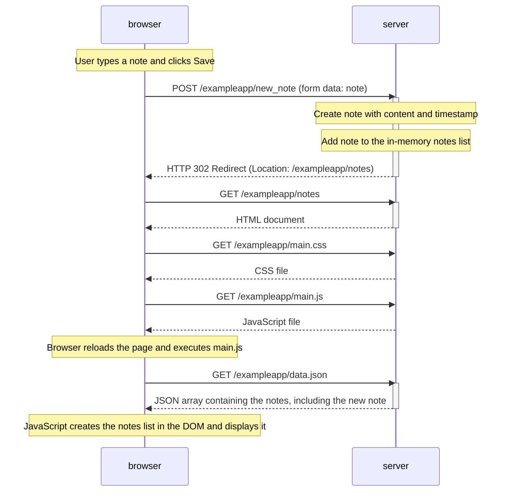

# Exercise 0.4: New note

The traditional form submission causes a page reload. The server responds to the POST with a redirect, and the browser then requests the notes page and its resources again.
