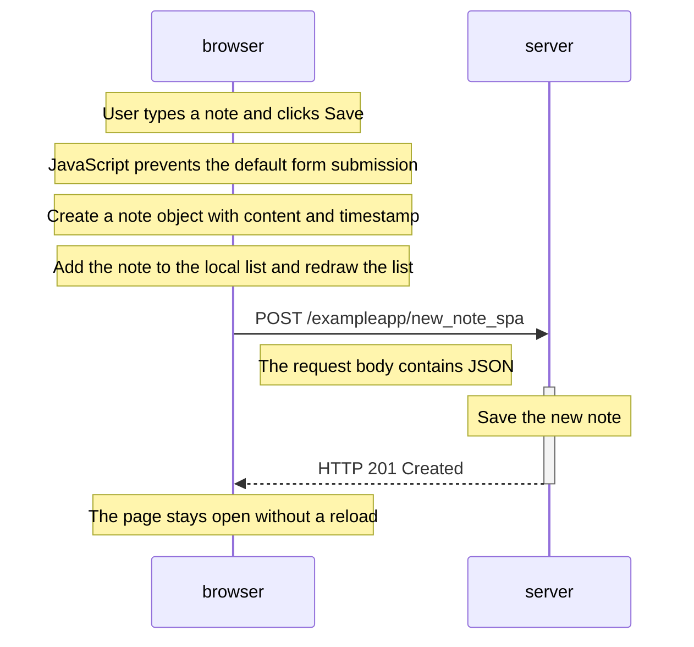

# Exercise 0.6: New note in the single-page app

The single-page app prevents the form's default submission. It adds the note to the page immediately and sends the note to the server as JSON in one POST request. The server saves the note and responds with HTTP 201 Created. The browser does not navigate to a new page.
